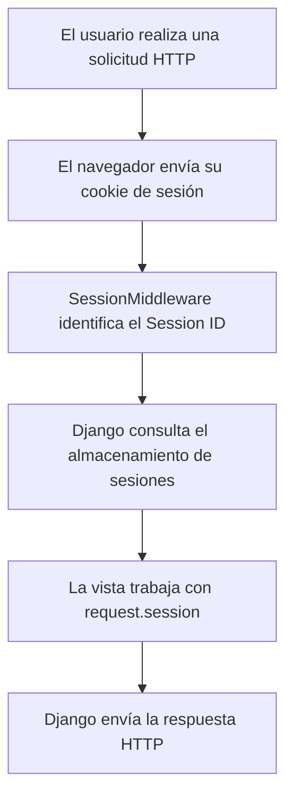

# Guía completa: sesiones y cookies en Django

**Análisis y consolidación de dos presentaciones de clase**  
**Área:** Tecnologías de Información y Ciberseguridad  
**Tema:** Gestión de estado en aplicaciones web modernas  
**Formato:** Markdown (`.md`)  

## Materiales analizados

1. **`Session_Django.pptx`** — *Guía: Uso de Sesiones en Django*. **8 diapositivas**. Docente: **Sebastián Pizarro**.
2. **`Cookies_Session_Django.pptx`** — *Django Sessions & Cookies: Gestión de Estado en Aplicaciones Web Modernas*. **12 diapositivas**. Área Tecnologías de Información y Ciberseguridad, **Sede Santiago Centro, 2026**.

Se revisaron **20 diapositivas** en total, incluyendo textos, fragmentos de código, tabla comparativa y gráfico de factores críticos. Este documento reúne **todos los conceptos, configuraciones, ejemplos y conclusiones que presentan**, e incluye explicaciones para estudiar. Cuando se corrige la sintaxis de algún ejemplo o se agrega una precisión técnica, se indica expresamente para no confundir el contenido de las clases con una ampliación.

---

## Índice

1. [Introducción: gestión de estado y HTTP](#1-introducción-gestión-de-estado-y-http)
2. [Qué es una cookie](#2-qué-es-una-cookie)
3. [Qué es una sesión](#3-qué-es-una-sesión)
4. [Comparación técnica: cookies frente a sesiones](#4-comparación-técnica-cookies-frente-a-sesiones)
5. [Cómo funciona una sesión: ciclo de vida](#5-cómo-funciona-una-sesión-ciclo-de-vida)
6. [Configuración de sesiones en `settings.py`](#6-configuración-de-sesiones-en-settingspy)
7. [Operaciones con sesiones en Django](#7-operaciones-con-sesiones-en-django)
8. [Ejemplo práctico de inicio y cierre de sesión](#8-ejemplo-práctico-de-inicio-y-cierre-de-sesión)
9. [Sesiones en vistas: segundo ejemplo de clase](#9-sesiones-en-vistas-segundo-ejemplo-de-clase)
10. [Uso de cookies en las vistas de Django](#10-uso-de-cookies-en-las-vistas-de-django)
11. [Base de datos y migraciones](#11-base-de-datos-y-migraciones)
12. [Factores críticos: seguridad y rendimiento](#12-factores-críticos-seguridad-y-rendimiento)
13. [Análisis y observaciones técnicas sobre las diapositivas](#13-análisis-y-observaciones-técnicas-sobre-las-diapositivas)
14. [Resumen para estudiar](#14-resumen-para-estudiar)
15. [Inventario completo por diapositiva](#15-inventario-completo-por-diapositiva)

---

## 1. Introducción: gestión de estado y HTTP

**Fuente:** `Cookies_Session_Django.pptx`, diapositivas 1 a 3; `Session_Django.pptx`, diapositiva 2.

### 1.1. ¿Qué es la gestión de estado?

La **gestión de estado** consiste en conservar información útil sobre un usuario o su interacción con una aplicación entre una solicitud HTTP y la siguiente.

Ejemplos mencionados en las presentaciones:

- Saber qué usuario ha iniciado sesión.
- Conservar productos agregados a un **carrito de compras**.
- Mantener datos o preferencias durante la navegación.

### 1.2. ¿Qué significa que HTTP sea *stateless*?

Las diapositivas indican que **HTTP es un protocolo sin estado** (*stateless*): cada petición o *request* se procesa de forma independiente. El protocolo, por sí solo, no guarda automáticamente el contexto de las peticiones anteriores.

**Problema descrito en la presentación:** sin un mecanismo adicional, el servidor no reconoce de manera continua a un usuario entre distintas peticiones y se pierde el contexto del inicio de sesión o del carrito.

**Ejemplo conceptual:**

1. Un usuario entra a una tienda virtual.
2. Agrega un artículo al carrito.
3. Accede a otra página.
4. Sin un mecanismo para conservar estado, la aplicación no sabría a qué carrito asociar la nueva petición.

### 1.3. Solución propuesta por Django

Django utiliza un componente llamado **middleware de sesiones**, que permite relacionar un **identificador de sesión** (*Session ID*) recibido mediante una **cookie** con los datos de esa sesión almacenados por el servidor.

La idea central de los PPTX es:

> **La cookie identifica la sesión; Django recupera los datos asociados y los pone a disposición de la vista mediante `request.session`.**

Esto permite mantener información entre solicitudes del mismo usuario.

---

## 2. Qué es una cookie

**Fuente:** `Cookies_Session_Django.pptx`, diapositivas 4, 6 y 10.

Una **cookie** es un pequeño dato que el navegador del cliente almacena y que puede enviar al servidor en futuras solicitudes al sitio correspondiente.

### 2.1. Características indicadas en clase

| Aspecto | Descripción presentada |
|---|---|
| Ubicación | Navegador del cliente (*browser*). |
| Tamaño | Aproximadamente **4 KB**. |
| Visibilidad | El contenido puede ser observado por el cliente; la presentación lo describe como visible y editable. |
| Uso recomendado | Guardar preferencias como **idioma** o **tema visual**. |
| Velocidad | El gráfico de la clase presenta la velocidad de las cookies como **alta**. |

**Precisión:** el límite de ~4 KB se refiere habitualmente al tamaño aproximado **por cookie**, no a una cuota total de 4 KB para todas las cookies de un sitio. Además, algunas cookies pueden restringir el acceso desde JavaScript mediante `HttpOnly`, aunque sigan almacenándose en el navegador.

### 2.2. Ejemplo conceptual

Una aplicación quiere recordar que el usuario prefiere español de Chile:

```text
Nombre de cookie: lang
Valor: es-cl
```

La aplicación podrá leer ese valor en otra solicitud y seleccionar el idioma correspondiente.

### 2.3. Advertencia importante

Una cookie normal del cliente **no es un lugar seguro para guardar contraseñas ni secretos**. Las cookies pueden ser robadas, modificadas o reutilizadas en determinadas condiciones, por lo que deben configurarse y validarse adecuadamente.

---

## 3. Qué es una sesión

**Fuente:** `Session_Django.pptx`, diapositiva 2; `Cookies_Session_Django.pptx`, diapositivas 3 y 5.

Una **sesión** es un mecanismo que permite **mantener datos entre las solicitudes de un mismo usuario**.

En los ejemplos de clase, las sesiones sirven para:

- Recordar un nombre de usuario.
- Mantener un indicador de inicio de sesión.
- Guardar información de un carrito.
- Preservar información durante la navegación.

### 3.1. Dónde se guarda la información

Según las presentaciones, en el funcionamiento habitual de Django:

- Los **datos de sesión** se almacenan en el servidor.
- El almacenamiento predeterminado es una **base de datos**.
- El navegador conserva una **cookie con el identificador de sesión**, en lugar de todos los datos guardados en ella.
- Desde una vista de Django, la información se consulta o modifica mediante **`request.session`**.

**Precisión:** Django también ofrece otros motores de sesiones (por ejemplo, caché o archivos). Las afirmaciones sobre datos almacenados en servidor y base de datos corresponden al **backend de base de datos** que enseñan las diapositivas. Hay incluso un backend de cookies firmadas cuyo comportamiento es diferente.

### 3.2. Qué es `request.session`

`request.session` es la interfaz que utiliza una vista para trabajar con los datos de la sesión actual. Se utiliza con claves y valores, de forma similar a un diccionario de Python.

Ejemplo incluido en la clase:

```python
request.session['username'] = 'JohnDoe'
```

Esto guarda el valor `JohnDoe` asociado a la clave `username` de esa sesión.

Para consultar un valor:

```python
username = request.session.get('username', 'Guest')
```

En este caso, si la clave no existe, se obtiene `Guest` como valor alternativo.

### 3.3. Capacidad de almacenamiento

La segunda presentación describe la capacidad de las sesiones como **«sin límite técnico real»** o **«ilimitada (depende de DB)»**.

**Precisión:** no existe el límite pequeño típico de una cookie para los datos de sesión del lado del servidor, pero sí existen límites prácticos de base de datos, memoria, almacenamiento y rendimiento. Conviene guardar solamente los datos necesarios.

---

## 4. Comparación técnica: cookies frente a sesiones

**Fuente:** `Cookies_Session_Django.pptx`, diapositivas 4 a 7.

La siguiente tabla reproduce el **sentido de la comparativa de la diapositiva 6**.

| Característica | Cookie | Sesión con backend de base de datos |
|---|---|---|
| Almacenamiento | Cliente: navegador. | Servidor: base de datos. |
| Seguridad, según la presentación | Baja: datos expuestos. | Alta: datos ocultos al navegador. |
| Capacidad, según la presentación | Aproximadamente 4 KB. | Mayor capacidad, dependiente de la base de datos. |
| Uso recomendado | Preferencias de idioma y tema. | Autenticación y carritos de compras. |
| Rendimiento, según el gráfico | Velocidad alta. | Velocidad media cuando requiere acceso a DB (*DB I/O*). |

### 4.1. Diferencia esencial

- **Cookie:** el navegador almacena directamente el dato.
- **Sesión de servidor:** el navegador suele almacenar un identificador y el servidor conserva los datos correspondientes.

### 4.2. Ejemplos de uso

**Guardar una preferencia:**

```python
response.set_cookie('lang', 'es-cl', max_age=3600)
```

**Guardar un dato en sesión:**

```python
request.session['username'] = 'JohnDoe'
```

Aunque ambos mecanismos sirven para conservar estado, **no son equivalentes** en ubicación, exposición de datos ni funcionamiento.

### 4.3. Matiz de seguridad

La tabla de clase contrasta la seguridad de ambos mecanismos con las etiquetas **baja** y **alta**. Es una simplificación didáctica: usar sesiones del lado del servidor reduce la exposición de los datos almacenados, pero **no convierte automáticamente una aplicación en segura**. Si alguien obtiene una cookie de sesión válida, puede intentar utilizarla para hacerse pasar por el usuario.

---

## 5. Cómo funciona una sesión: ciclo de vida

**Fuente:** `Cookies_Session_Django.pptx`, diapositivas 3 y 11.

El diagrama **«Ciclo de Vida de la Sesión»**, de la diapositiva 11, muestra cuatro etapas:

1. **Usuario hace Request:** el navegador realiza una solicitud HTTP a la aplicación.
2. **Middleware busca Session ID:** Django identifica el ID de sesión recibido en la cookie.
3. **Django carga datos desde DB:** con el backend de base de datos, Django obtiene la información asociada a ese ID.
4. **View accede a `request.session`:** la vista utiliza los datos recuperados.

### 5.1. Diagrama de flujo basado en la presentación



**Aclaración:** los cuatro pasos centrales están en la diapositiva 11. La mención explícita del navegador y la respuesta final amplía la secuencia para entenderla de principio a fin.

### 5.2. Ejemplo de navegación

Imaginemos una aplicación con un panel personal:

1. El sistema registra en sesión `username = 'estudiante_inacap'`.
2. El navegador conserva el identificador de esa sesión.
3. En una nueva petición al panel, Django recupera el estado.
4. La vista obtiene el nombre con `request.session.get('username')`.
5. El panel muestra el nombre almacenado.

---

## 6. Configuración de sesiones en `settings.py`

**Fuentes:** `Session_Django.pptx`, diapositiva 3; `Cookies_Session_Django.pptx`, diapositiva 8.

Ambas presentaciones configuran el manejo de sesiones en el archivo **`settings.py`**, pero emplean **dos políticas de duración distintas**. Son ejemplos alternativos, no valores que deban activarse simultáneamente.

### 6.1. Primer PPTX: sesión de una hora y cierre del navegador

Configuración de la diapositiva 3 de `Session_Django.pptx`:

```python
SESSION_ENGINE = 'django.contrib.sessions.backends.db'
SESSION_COOKIE_AGE = 3600  # Tiempo de vida de 1 hora
SESSION_EXPIRE_AT_BROWSER_CLOSE = True  # Expira al cerrar navegador
```

**Qué significa cada línea:**

- **`SESSION_ENGINE`**: selecciona el motor de sesiones de base de datos.
- **`SESSION_COOKIE_AGE = 3600`**: define una duración de **3.600 segundos**, equivalente a **1 hora**.
- **`SESSION_EXPIRE_AT_BROWSER_CLOSE = True`**: indica que la cookie de sesión se configure para expirar al terminar la sesión del navegador.

**Interpretación:** este ejemplo busca una política de persistencia más corta.

### 6.2. Segundo PPTX: duración de dos semanas

Configuración de la diapositiva 8 de `Cookies_Session_Django.pptx`, presentada aquí con **formato Python válido**:

```python
INSTALLED_APPS = [
    'django.contrib.sessions',  # Habilitar la aplicación de sesiones
    # ... otras aplicaciones ya presentes en el proyecto
]

MIDDLEWARE = [
    'django.contrib.sessions.middleware.SessionMiddleware',  # Procesar sesiones
    # ... otros middleware ya presentes en el proyecto
]

SESSION_COOKIE_AGE = 1209600  # 2 semanas en segundos
SESSION_EXPIRE_AT_BROWSER_CLOSE = False
```

**Importante:** estas listas son **esquemáticas**. En un proyecto real deben **conservarse las demás entradas** de `INSTALLED_APPS` y `MIDDLEWARE`; no deben reemplazarse por listas incompletas. El segundo PPTX presenta las listas resumidas en una sola línea, por lo que aquí se separaron para que resulten legibles.

**Qué significa cada valor:**

- **`django.contrib.sessions`**: aplicación de sesiones incluida en Django.
- **`SessionMiddleware`**: middleware encargado de agregar el manejo de sesiones a cada solicitud.
- **`SESSION_COOKIE_AGE = 1209600`**: duración de **1.209.600 segundos = 14 días = 2 semanas**.
- **`SESSION_EXPIRE_AT_BROWSER_CLOSE = False`**: la cookie de sesión puede mantenerse después de cerrar el navegador, conforme a su caducidad.

### 6.3. Comparación de las dos configuraciones de clase

| Parámetro | `Session_Django.pptx` | `Cookies_Session_Django.pptx` |
|---|---|---|
| Backend | Base de datos. | No lo declara explícitamente en ese ejemplo; se explica que DB es el predeterminado. |
| Duración (`SESSION_COOKIE_AGE`) | 3.600 segundos / 1 hora. | 1.209.600 segundos / 2 semanas. |
| Expirar al cerrar navegador | `True`. | `False`. |
| `INSTALLED_APPS` | No se muestra en la diapositiva de configuración. | Incluye `django.contrib.sessions`. |
| `MIDDLEWARE` | No se muestra en la diapositiva de configuración. | Incluye `SessionMiddleware`. |

**Conclusión:** la diferencia es **de configuración de persistencia**, no una contradicción del funcionamiento de Django. Debe elegirse una política acorde con los requisitos del sistema.

### 6.4. Matices sobre expiración

La duración de la cookie y el cierre del navegador no equivalen necesariamente a la destrucción instantánea de todos los registros en la base de datos. Además, los navegadores pueden restaurar sesiones al reabrirse. La aplicación debe gestionar correctamente la expiración y el cierre de sesión.

---

## 7. Operaciones con sesiones en Django

**Fuente:** `Session_Django.pptx`, diapositivas 4, 5 y 6.

Estas operaciones usan **`request.session`**.

### 7.1. Establecer datos en sesión

El primer PPTX incluye este ejemplo:

```python
from django.http import HttpResponse


def set_session(request):
    request.session['username'] = 'JohnDoe'
    request.session['is_logged_in'] = True
    return HttpResponse('Sesión iniciada')
```

**Explicación paso a paso:**

1. `set_session` recibe una solicitud HTTP mediante `request`.
2. Se almacena el nombre `JohnDoe` con la clave `username`.
3. Se almacena `True` con la clave `is_logged_in`.
4. Django devuelve una respuesta que dice **«Sesión iniciada»**.

**Advertencia:** establecer `is_logged_in = True` solo guarda un indicador en una sesión. **No comprueba credenciales ni autentica realmente al usuario.** Este ejemplo ilustra almacenamiento, no un inicio de sesión seguro.

### 7.2. Obtener datos de la sesión

El ejemplo de la diapositiva 5:

```python
from django.http import HttpResponse


def get_session(request):
    username = request.session.get('username', 'Guest')
    return HttpResponse(f'Hola, {username}')
```

**Explicación:**

- `.get('username', 'Guest')` busca la clave `username`.
- Si existe, obtiene su valor.
- Si no existe, utiliza el valor por defecto `Guest`.
- Devuelve un saludo con el nombre obtenido.

**Resultados posibles:**

```text
Hola, JohnDoe
Hola, Guest
```

### 7.3. Eliminar un dato específico

Ejemplo de la diapositiva 6, con comillas normalizadas:

```python
from django.http import HttpResponse


def delete_username(request):
    del request.session['username']
    return HttpResponse('Usuario eliminado de la sesión')
```

**Qué hace:** elimina **solamente la clave `username`**. Otros datos de la sesión, como `is_logged_in`, pueden seguir existiendo.

**Precisión importante:** si no existe `username`, `del request.session['username']` puede producir un error de clave (`KeyError`). Una variante más tolerante, **no incluida en el PPTX**, es:

```python
request.session.pop('username', None)
```

### 7.4. Eliminar toda la sesión

Ejemplo de la diapositiva 6:

```python
from django.http import HttpResponse


def clear_session(request):
    request.session.flush()
    return HttpResponse('Sesión eliminada')
```

**Qué hace `flush()`:** descarta los datos de la sesión actual y su identificador, evitando que ese identificador siga utilizándose para consultar la misma sesión.

### 7.5. Diferencia entre borrar una clave y usar `flush()`

| Código | Resultado |
|---|---|
| `del request.session['username']` | Quita una clave específica. |
| `request.session.pop('username', None)` | Quita una clave específica sin error si no existe; es una ampliación técnica. |
| `request.session.flush()` | Descarta la sesión actual completa. |

---

## 8. Ejemplo práctico de inicio y cierre de sesión

**Fuente:** `Session_Django.pptx`, diapositiva 7.

La primera presentación propone **tres vistas**: `login`, `home` y `logout`. A continuación se muestra el mismo flujo con indentación y sintaxis válidas.

> **Atención:** es un **ejemplo académico simplificado**. No valida contraseñas, no comprueba métodos HTTP ni utiliza el sistema de autenticación real de Django. No debe usarse sin cambios para autenticar usuarios en producción.

### 8.1. Vista de inicio de sesión

```python
def login(request):
    username = request.POST['username']
    request.session['username'] = username
    return redirect('home')
```

**Qué hace:**

1. Lee un campo `username` enviado mediante `POST`.
2. Guarda ese valor en la sesión.
3. Redirige al usuario a una ruta llamada `home`.

**Posible problema:** si no se envía `username`, el acceso con corchetes puede generar un error. Además, esta vista no verifica la identidad de quien envía el nombre.

### 8.2. Vista principal o de inicio

```python
def home(request):
    username = request.session.get('username', 'Guest')
    return HttpResponse(f'Bienvenido, {username}')
```

**Qué hace:** recupera el nombre de la sesión y responde con un saludo. Si no se encuentra, muestra `Guest`.

### 8.3. Vista de cierre de sesión

```python
def logout(request):
    request.session.flush()
    return redirect('login')
```

**Qué hace:** limpia la sesión y redirige a una ruta llamada `login`.

### 8.4. Flujo completo

```text
Formulario con username
        |
        v
Vista login(request)
        |
        v
request.session['username'] = username
        |
        v
Redirección a home
        |
        v
home(request) lee request.session
        |
        v
Muestra "Bienvenido, <usuario>"
        |
        v
logout(request) ejecuta flush()
        |
        v
Redirección a login
```

**Nota sobre el código:** el PPTX emplea las funciones llamadas `login` y `logout`. En proyectos reales, conviene evitar confusiones con las funciones `login()` y `logout()` del módulo `django.contrib.auth`, que cumplen una función de autenticación más completa.

---

## 9. Sesiones en vistas: segundo ejemplo de clase

**Fuente:** `Cookies_Session_Django.pptx`, diapositiva 9.

Este ejemplo usa el nombre **`estudiante_inacap`** y una vista `dashboard`.

### 9.1. Código mostrado, con formato y retorno corregidos

El código de la diapositiva contiene saltos de línea, comillas tipográficas y una función que no devuelve respuesta. Esta es una **versión corregida para facilitar su lectura y ejecución**, conservando la idea enseñada:

```python
from django.http import HttpResponse
from django.shortcuts import render


def login_view(request):
    # Guardar en sesión
    request.session['username'] = 'estudiante_inacap'
    request.session['is_auth'] = True
    return HttpResponse('Datos guardados en la sesión')


def dashboard(request):
    # Leer desde sesión
    user = request.session.get('username', 'Anónimo')
    return render(request, 'dashboard.html', {'user': user})
```

**Cambios introducidos al normalizar el fragmento:** se separaron las funciones, se corrigieron las comillas, se agregó indentación y se añadió `return HttpResponse(...)` en `login_view`, ya que las vistas de Django deben devolver una respuesta HTTP.

### 9.2. Explicación de cada instrucción

- `request.session['username'] = 'estudiante_inacap'`: guarda el nombre del usuario en sesión.
- `request.session['is_auth'] = True`: guarda un indicador booleano de ejemplo; **no es autenticación real**.
- `request.session.get('username', 'Anónimo')`: lee el nombre de usuario o utiliza `Anónimo` si no existe.
- `render(request, 'dashboard.html', {'user': user})`: genera una respuesta HTML utilizando la plantilla `dashboard.html` y enviando el valor bajo la clave de contexto `user`.

### 9.3. Relación con las plantillas de Django

En el último `render`, el diccionario:

```python
{'user': user}
```

hace que la plantilla pueda acceder a `user`.

**Ampliación explicativa — plantilla mínima ilustrativa, no incluida en el PPTX:**

```html
<h1>Bienvenido, {{ user }}</h1>
```

---

## 10. Uso de cookies en las vistas de Django

**Fuente:** `Cookies_Session_Django.pptx`, diapositiva 10.

La presentación muestra dos vistas: una que **establece** una cookie y otra que **lee** el valor de esa cookie.

### 10.1. Crear una cookie

Código de clase, con formato corregido:

```python
from django.http import HttpResponse


def set_cookie(request):
    response = HttpResponse('Configurando idioma')
    response.set_cookie('lang', 'es-cl', max_age=3600)
    return response
```

**Explicación:**

1. `HttpResponse('Configurando idioma')` crea una respuesta HTTP.
2. `set_cookie(...)` establece en esa respuesta una cookie de nombre `lang`.
3. El valor de la cookie es `es-cl` (**español de Chile**).
4. `max_age=3600` define una vigencia de **una hora**.
5. La vista devuelve la respuesta con la indicación de establecer la cookie.

### 10.2. Leer una cookie

Código de clase, con formato corregido:

```python
from django.http import HttpResponse


def get_cookie(request):
    lang = request.COOKIES.get('lang', 'en')
    return HttpResponse(f'Idioma: {lang}')
```

**Explicación:**

- `request.COOKIES` contiene los valores de cookies disponibles en la solicitud.
- `.get('lang', 'en')` busca el idioma almacenado.
- Si no se encuentra `lang`, el ejemplo utiliza **`en`** como valor por defecto.
- Se genera una respuesta con el idioma encontrado.

**Resultados posibles:**

```text
Idioma: es-cl
Idioma: en
```

### 10.3. Diferencia de instrucciones para cookies y sesiones

| Acción | Sesiones | Cookies |
|---|---|---|
| Guardar dato | `request.session['clave'] = valor` | `response.set_cookie('clave', valor)` |
| Leer dato | `request.session.get('clave')` | `request.COOKIES.get('clave')` |
| Ubicación en el ejemplo | Servidor / base de datos | Navegador |
| Valor usado en las diapositivas | `username`, `is_logged_in`, `is_auth` | `lang` |

**Ampliación no incluida en el PPTX:** Django permite eliminar una cookie desde una respuesta mediante `response.delete_cookie('lang')`. El segundo PPTX enseña establecer y leer cookies, pero **no muestra un método de borrado**.

---

## 11. Base de datos y migraciones

**Fuente:** `Session_Django.pptx`, diapositiva 8.

Si se utiliza el **backend de sesiones en base de datos**, se debe contar con la tabla que almacena la información de sesión.

### 11.1. Comando de la presentación

Desde el directorio del proyecto Django en el que se encuentra `manage.py`, ejecutar:

```bash
python manage.py migrate
```

La diapositiva explica que este comando **crea la tabla necesaria para almacenar las sesiones**, si todavía no existe y las migraciones de la aplicación están pendientes.

### 11.2. Qué ocurre conceptualmente

1. Django revisa las migraciones de las aplicaciones instaladas.
2. Aplica las migraciones pendientes.
3. Si está instalada `django.contrib.sessions` y se utiliza el sistema de base de datos, se crea la estructura correspondiente.
4. La aplicación puede persistir sesiones mediante el backend configurado.

**Precisión técnica:** la tabla predeterminada se llama **`django_session`**. Este nombre no figura expresamente en la diapositiva: se agrega para facilitar su identificación en la base de datos.

### 11.3. Relación con el ciclo de vida

La tabla es el almacenamiento consultado por Django en el **paso 3** del diagrama de ciclo de vida cuando se usa el backend de base de datos.

---

## 12. Factores críticos: seguridad y rendimiento

**Fuente:** `Cookies_Session_Django.pptx`, diapositiva 7.

La diapositiva «**Factores Críticos**» presenta un gráfico de cuatro barras horizontales. Sus etiquetas son:

| Factor del gráfico | Etiqueta que aparece |
|---|---|
| Seguridad Session | **Crítico** |
| Seguridad Cookie | **Vulnerable** |
| Velocidad Cookie | **Alta** |
| Velocidad Session | **Media (DB I/O)** |

El gráfico es **ilustrativo**: no contiene cifras, porcentajes, unidades de medición ni resultados de pruebas de rendimiento. Por tanto, **no se debe interpretar la longitud de sus barras como una medición cuantitativa verificable**.

### 12.1. Lectura del gráfico

- **Seguridad de la sesión:** se presenta como un factor crítico que debe atenderse.
- **Seguridad de la cookie:** el gráfico destaca su posible vulnerabilidad.
- **Velocidad de las cookies:** se muestra como alta en la comparación conceptual.
- **Velocidad de las sesiones:** se muestra como media, vinculada al acceso de entrada/salida a la base de datos (*DB I/O*).

### 12.2. Relación con lo visto anteriormente

Cuando el servidor debe consultar información guardada en base de datos, puede producirse trabajo adicional de lectura o escritura. Por el contrario, una cookie que contiene directamente una preferencia puede consultarse sin ir a buscar ese dato a la tabla de sesiones. La elección depende de la **sensibilidad de los datos, el objetivo funcional y la arquitectura de la aplicación**.

**Precisión:** el rendimiento real depende del backend utilizado, la caché, la red, el tamaño de los datos y la carga del sistema. La figura no demuestra que todas las cookies sean siempre más rápidas que todas las sesiones.

### 12.3. Medidas de seguridad adicionales para estudiar

> **Apartado complementario:** estas recomendaciones **no se desarrollan en las diapositivas**, pero ayudan a interpretar sus advertencias sobre seguridad.

- Mantener el sitio en **HTTPS** y configurar `SESSION_COOKIE_SECURE = True` en producción HTTPS.
- Evitar que JavaScript lea la cookie de sesión usando `SESSION_COOKIE_HTTPONLY = True` cuando corresponda (valor predeterminado habitual de Django).
- Revisar `SESSION_COOKIE_SAMESITE` y conservar las protecciones CSRF.
- Utilizar la autenticación oficial de Django, por ejemplo `django.contrib.auth.authenticate`, `login` y `logout`, para verificar credenciales y gestionar sesiones de usuario.
- No poner contraseñas u otros secretos en cookies simples ni almacenar información innecesaria en la sesión.
- Cerrar las sesiones correctamente y controlar sus tiempos de expiración.

**Advertencia de enfoque:** una sesión del lado del servidor no elimina por sí sola los riesgos de robo o uso indebido de identificadores de sesión.

---

## 13. Análisis y observaciones técnicas sobre las diapositivas

Esta sección **no reemplaza el contenido de las clases**. Identifica decisiones didácticas y detalles que conviene tener presentes si se copia el código o se aplica a un proyecto real.

### 13.1. Lo que ambos PPTX enseñan en común

- Las aplicaciones necesitan mantener información entre distintas peticiones HTTP.
- Las sesiones son un mecanismo para resolver este problema.
- En los ejemplos de Django, el identificador se transporta mediante cookie y los datos se gestionan desde `request.session`.
- Se utilizan ejemplos de usuario autenticado, panel de bienvenida y carritos.
- Las sesiones tienen parámetros configurables de duración.

### 13.2. Aportes específicos de cada presentación

**`Session_Django.pptx` se enfoca en la práctica:**

- Configurar el motor y la duración de sesión.
- Guardar valores con corchetes.
- Consultar valores con `.get()`.
- Eliminar claves específicas con `del`.
- Terminar la sesión con `flush()`.
- Simular un flujo de login / home / logout.
- Ejecutar `python manage.py migrate`.

**`Cookies_Session_Django.pptx` aporta el marco conceptual y comparativo:**

- Explicar que HTTP es *stateless*.
- Definir cookie y sesión.
- Comparar ubicación, capacidad, seguridad y usos recomendados.
- Presentar factores críticos mediante barras.
- Mostrar cómo activar `django.contrib.sessions` y `SessionMiddleware`.
- Guardar y consultar sesiones desde vistas.
- Crear y leer cookies con `set_cookie` y `request.COOKIES`.
- Explicar las cuatro fases del ciclo de vida de una sesión.

### 13.3. Diferentes tiempos de expiración

El primer PPTX utiliza **1 hora** y expiración al cerrar navegador; el segundo utiliza **2 semanas** sin exigir expiración al cerrar navegador. Ambos ejemplos son configuraciones distintas y **no se deben mezclar sin decidir cuál política se necesita**.

### 13.4. Errores de formato en fragmentos del segundo PPTX

En las diapositivas 8 a 10 aparecen fragmentos muy condensados, comillas tipográficas y saltos de línea que no representan Python listo para ejecutar. En este documento se:

- Normalizaron comillas y tabulaciones.
- Separaron instrucciones y funciones.
- Ajustó la indentación.
- Agregaron las importaciones necesarias para mostrar los ejemplos de forma independiente.
- Agregó una respuesta HTTP a `login_view`, ausente en el fragmento original.

Estos son **arreglos de presentación y funcionalidad**, no cambios en el objetivo de los ejercicios.

### 13.5. Los ejemplos de «login» no validan realmente identidades

Los ejemplos académicos almacenan un nombre de usuario o un booleano (`is_logged_in` o `is_auth`). Eso demuestra **persistencia de datos**, pero **no equivale a verificar credenciales de usuario**. Un sistema real debería utilizar las herramientas de autenticación y autorización de Django.

### 13.6. Seguridad de cookies y sesiones: interpretación correcta

La segunda presentación describe las cookies como vulnerables y las sesiones como seguras porque, en el backend analizado, los datos sensibles permanecen en el servidor. Esto describe una ventaja real de las sesiones del lado del servidor, pero es una **simplificación**: tanto las cookies como los identificadores de sesión requieren medidas de protección.

### 13.7. Capacidad y rendimiento: interpretación correcta

El límite aproximado de **4 KB** no significa que todas las cookies de un sitio compartan exactamente ese límite total. Del mismo modo, una sesión en base de datos no tiene capacidad infinita. La gráfica de seguridad y velocidad es cualitativa, no una prueba de rendimiento.

---

## 14. Resumen para estudiar

### 14.1. Conceptos imprescindibles

| Término | Qué recordar |
|---|---|
| **HTTP stateless** | Cada petición es independiente; se necesitan mecanismos para preservar contexto. |
| **Estado** | Datos que la aplicación necesita recordar entre peticiones. |
| **Cookie** | Pequeño dato almacenado en el navegador. |
| **Sesión** | Mecanismo para mantener información asociada a un usuario entre peticiones. |
| **Session ID** | Identificador utilizado para asociar una petición con una sesión. |
| **Middleware** | Componente que procesa peticiones y respuestas; el de sesiones facilita `request.session`. |
| **`request.session`** | Interfaz para trabajar con los datos de la sesión desde una vista. |
| **`request.COOKIES`** | Interfaz para consultar cookies recibidas en la petición. |
| **`response.set_cookie()`** | Método para establecer una cookie en la respuesta HTTP. |
| **`request.session.flush()`** | Operación para descartar la sesión actual. |
| **`python manage.py migrate`** | Comando que aplica migraciones de Django, incluidas las de sesiones cuando corresponde. |

### 14.2. Comandos y fragmentos que conviene memorizar

**Guardar una sesión:**

```python
request.session['username'] = 'JohnDoe'
```

**Leer una sesión:**

```python
username = request.session.get('username', 'Guest')
```

**Eliminar una clave:**

```python
del request.session['username']
```

**Eliminar una sesión completa:**

```python
request.session.flush()
```

**Establecer una cookie:**

```python
response.set_cookie('lang', 'es-cl', max_age=3600)
```

**Leer una cookie:**

```python
lang = request.COOKIES.get('lang', 'en')
```

**Crear las tablas mediante migraciones:**

```bash
python manage.py migrate
```

### 14.3. Preguntas de repaso basadas en los PPTX

1. ¿Qué significa que HTTP sea *stateless*?
2. ¿Por qué una aplicación necesita mantener estado entre peticiones?
3. ¿Dónde se almacena una cookie y dónde se almacena una sesión con backend de base de datos?
4. ¿Qué almacena normalmente la cookie asociada a una sesión de servidor?
5. ¿Para qué sirve `SessionMiddleware`?
6. ¿Qué diferencia hay entre guardar un dato con `request.session['clave']` y leerlo con `.get()`?
7. ¿Qué hace `request.session.flush()`?
8. ¿Qué diferencia hay entre `SESSION_COOKIE_AGE = 3600` y `SESSION_COOKIE_AGE = 1209600`?
9. ¿Qué efecto tiene `SESSION_EXPIRE_AT_BROWSER_CLOSE`?
10. ¿Para qué se ejecuta `python manage.py migrate`?
11. ¿Qué hace `response.set_cookie('lang', 'es-cl', max_age=3600)`?
12. ¿Por qué guardar `is_auth = True` no demuestra que una persona haya sido autenticada?

### 14.4. Conclusión general

Los dos materiales explican cómo **mantener el estado de una aplicación Django** y en qué se diferencian las **cookies** y las **sesiones**. Las cookies conservan pequeños datos en el navegador; las sesiones del lado del servidor permiten asociar un navegador con información almacenada en el backend de Django. La API esencial es **`request.session`**, mientras que el acceso a cookies se realiza mediante **`request.COOKIES`** y métodos de la respuesta HTTP. Las sesiones deben configurarse, migrarse cuando usan base de datos y protegerse adecuadamente.

---

## 15. Inventario completo por diapositiva

El siguiente inventario permite ubicar **todo el material original**, incluidas las diapositivas de portada y cierre, sin perder su procedencia.

### 15.1. `Session_Django.pptx` — 8 diapositivas

| Diapositiva | Título o asunto original | Contenido incorporado |
|---:|---|---|
| 1 | **Guía: Uso de Sesiones en Django** | Portada y docente Sebastián Pizarro, registrados en la identificación del material. |
| 2 | **¿Qué son las sesiones en Django?** | Mantenimiento de datos entre solicitudes; uso para login, carrito y `request.session`. Secciones 1 y 3. |
| 3 | **Configuración básica** | `SESSION_ENGINE`, `SESSION_COOKIE_AGE = 3600` y `SESSION_EXPIRE_AT_BROWSER_CLOSE = True`. Sección 6. |
| 4 | **Establecer datos en la sesión** | Vista `set_session`; claves `username` e `is_logged_in`. Sección 7.1. |
| 5 | **Obtener datos de la sesión** | Vista `get_session`; `.get('username', 'Guest')`. Sección 7.2. |
| 6 | **Eliminar datos de la sesión** | Vista `delete_username`; operación `del`; vista `clear_session` y `flush()`. Secciones 7.3 a 7.5. |
| 7 | **Ejemplo práctico completo** | Vistas `login`, `home` y `logout`; guardado, lectura, `flush()` y redirecciones. Sección 8. |
| 8 | **Creación de la tabla de sesiones** | Backend de base de datos y comando `python manage.py migrate`. Sección 11. |

### 15.2. `Cookies_Session_Django.pptx` — 12 diapositivas

| Diapositiva | Título o asunto original | Contenido incorporado |
|---:|---|---|
| 1 | **Django Sessions & Cookies** | Portada; subtítulo «Gestión de Estado en Aplicaciones Web Modernas»; área de TI y Ciberseguridad. |
| 2 | **Gestión de Estado** | Pregunta: «¿Por qué necesitamos persistencia en un protocolo Stateless?». Sección 1. |
| 3 | **El Problema: HTTP es Stateless** | Tarjetas visuales «Sin Persistencia» y «La Solución»; independencia de requests; middleware y Session ID. Sección 1. |
| 4 | **¿Qué es una Cookie?** | Almacenamiento en navegador, ~4 KB, visibilidad y posibilidad de edición. Sección 2. |
| 5 | **¿Qué es una Session?** | Almacenamiento en servidor, DB por defecto, capacidad y vínculo mediante cookie. Sección 3. |
| 6 | **Comparativa Técnica** | Tabla de cuatro características: almacenamiento, seguridad, capacidad y uso recomendado. Sección 4. |
| 7 | **Factores Críticos** | Gráfico de barras con etiquetas «Seguridad Session — Crítico», «Seguridad Cookie — Vulnerable», «Velocidad Cookie — Alta» y «Velocidad Session — Media (DB I/O)». Sección 12. |
| 8 | **Configuración: settings.py** | `INSTALLED_APPS`, `MIDDLEWARE`, duración de dos semanas y `SESSION_EXPIRE_AT_BROWSER_CLOSE = False`. Sección 6. |
| 9 | **Uso de Sessions en Views** | Guardar `estudiante_inacap`, `is_auth`, leer nombre con `.get()`, renderizar `dashboard.html`. Sección 9. |
| 10 | **Uso de Cookies en Views** | `set_cookie`, `get_cookie`, cookie `lang = es-cl`, vigencia de 3.600 segundos y valor por defecto `en`. Sección 10. |
| 11 | **Ciclo de Vida de la Sesión** | Diagrama visual de cuatro etapas: request, middleware, carga desde DB y acceso desde view. Sección 5. |
| 12 | **¿CONSULTAS?** | Diapositiva de cierre. «Django Sessions & Cookies – Material de Apoyo»; Área Tecnologías de Información y Ciberseguridad; **Sede Santiago Centro – 2026**. |

---

## Nota sobre fidelidad a las fuentes

- **Contenido de los PPTX:** se preservaron temas, nombres de variables, valores numéricos, funcionalidades de los ejemplos, tabla comparativa, etiquetas de gráfico, ciclo de vida, docente y datos de las portadas.
- **Normalización editorial:** los ejemplos de código se formatearon para corregir comillas tipográficas, separación de funciones, indentación e importaciones. En el ejemplo `login_view` del segundo PPTX se añadió expresamente una respuesta HTTP que faltaba en el fragmento.
- **Explicaciones complementarias:** las aclaraciones sobre autenticación real, límites de cookies, duración práctica, backend alternativos, manejo de errores, seguridad y sintaxis se identifican como precisiones o ampliaciones; **no deben atribuirse literalmente a las diapositivas**.
- **No se incorporó contenido de fuentes externas:** el análisis tiene como base los dos archivos entregados.
